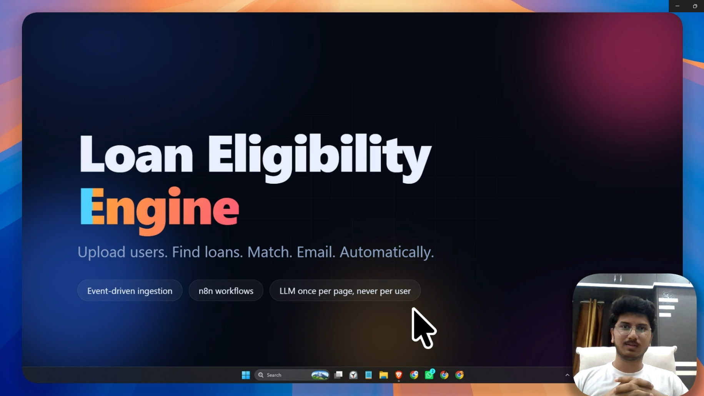
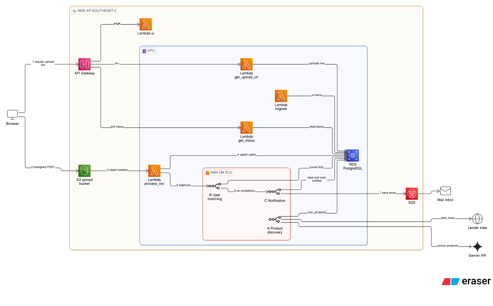

# Loan Eligibility Engine

Upload a CSV of users. The system crawls loan products from lender websites, matches each user to the products they qualify for, and emails them.

Ingestion runs on Lambda and S3, data lives in PostgreSQL, and all business logic runs in self-hosted n8n workflows.

---

## Deliverables

| Item | Where |
|---|---|
| Demo video | <a href="https://shorturl.at/Brhjw"></a><br>▶ <b>Click the image to watch the demo</b> (end to end) |
| AWS infrastructure | [serverless.yml](serverless.yml) |
| n8n launch | • [docker-compose.aws.yml](docker-compose.aws.yml) (n8n on EC2) |
| n8n workflows | • [A · Product discovery](n8n/workflows/a_product_discovery.json)<br>• [B · User matching](n8n/workflows/b_user_matching.json)<br>• [C · Notification (AWS SES)](n8n/workflows/variants/c_notification_ses.json) |
| Documentation | [Architecture](#architecture) · [Setup and deployment](#setup-and-deployment) · [Design decisions](#design-decisions) |

---

## Architecture



1. The browser requests an upload link from API Gateway (Lambda `get_upload_url`).
2. The browser uploads the CSV **directly to S3** (presigned POST).
3. The S3 event starts Lambda `process_csv`.
4. It validates rows and upserts users into RDS.
5. It calls n8n **workflow B** (webhook, secret header).
6. B matches users to products and calls **workflow C**.
7. C emails matched users through SES.

**Workflow A** runs separately every day: it crawls lender pages, extracts products with Gemini and stores them.

Deployed with the Serverless Framework. RDS is private; Lambda, RDS and n8n (Docker on EC2) share one VPC. Locally the same code runs on Docker Compose: MinIO replaces S3 and a small Flask app replaces API Gateway.

---

## Setup and deployment

### Local (Docker Compose)

Needs Docker, Python 3 and a Gemini API key.

```bash
cp .env.example .env            # fill in passwords, GEMINI_API_KEY, GMAIL_APP_PASSWORD, NOTIFY_RECIPIENTS
docker compose up -d --build    # Postgres, MinIO, API, n8n; migrations run automatically
```

1. Open http://localhost:5678 and create the n8n owner account.
2. `python scripts/n8n_setup.py` creates the credentials and imports and publishes the three workflows.
3. In n8n, open **A - Loan Product Discovery** and click **Execute workflow**.
4. Open http://localhost:8000 and upload a CSV: the assessment's sample, or one you generate with `python scripts/generate_sample_users.py` (10,000 synthetic users in `data/users.csv`). For a small file with edge cases, add `--rows 20 --edge-cases --out data/demo_users.csv`.

### AWS

Needs an AWS account with access keys, Node.js, Docker, and the sender and recipient addresses verified in SES.

```bash
cp .env.aws.example .env.aws    # fill in
npm install
python scripts/aws_deploy.py    # stack, n8n host, migrations
python scripts/aws_teardown.py  # delete everything
```

Steps, costs and troubleshooting: [docs/aws-deployment.md](docs/aws-deployment.md).

### n8n credentials

The setup script creates these from `.env` / `.env.aws`. To create them by hand: **Credentials → Add credential**.

| Name | Type | Values |
|---|---|---|
| App Postgres | Postgres | host `postgres` (local) or the RDS endpoint, port 5432, database and user from the env file; SSL `require` on AWS |
| Gmail SMTP | SMTP | `smtp.gmail.com`, 465, SSL, Gmail address and app password (local) |
| AWS SES | AWS | region, access key ID, secret access key (AWS) |

Webhook secret, Gemini key and demo limits are container environment variables, read in nodes as `$env.*`. No secrets are stored in the workflow JSON.

---

## Design decisions

### Workflows

| | Trigger | Logic |
|---|---|---|
| **A** Product discovery | Daily 02:00, or manual | For each source: fetch, clean, hash. Unchanged: stop. Changed: Gemini extracts products, output is validated, and products and hash are saved in one statement. |
| **B** User matching | Webhook after a CSV is processed | Checks the secret, replies 202, then one SQL statement claims flagged users and products, applies the eligibility rules and stores matches. |
| **C** Notification | Called by B | Picks users with unsent matches, builds one email each (best 5 products), sends, and marks them notified only after a successful send. |

### Web crawling strategy

- **Sources:** Tata Capital, IDFC FIRST Bank and ICICI Bank personal-loan pages, stored in `crawl_sources`. Adding a site is one `INSERT`.
- **Fetch:** plain HTTP GET, once a day. All three pages include rates and eligibility in the HTML.
- **Clean:** strip scripts, styles, navigation, footers and embedded JSON; keep tables as text. About 95% smaller.
- **Change detection:** SHA-256 of the cleaned text. Unchanged pages cost no LLM call.
- **Extract:** an LLM with a strict JSON schema instead of CSS selectors, so layout changes do not break it. Unknown values are `null`. Different rules per employment type become separate products.
- **Safety:** output is validated before saving; failures are recorded with their reason; a failed crawl never removes products; a Gemini outage falls back to a second model.
- **Limits:** `robots.txt` is not consulted; a blocked site is recorded as `fetch_failed`.

### Optimization Treasure Hunt

**The LLM reads each product page once, not each user-product pair.** After that, matching is deterministic SQL: fast, free and explainable.

| Stage | What it does |
|---|---|
| 0. Incremental scope | Only flagged users and flagged products are evaluated |
| 1. Hard rules | One set-based SQL join: income, score, age, employment (null means no constraint) |
| 2. Rank and cap | `fit_score` (lower rate is better); top 5 per user when emailing |

Measured on the assessment's 10,000-user sample (`match_runs` table):

| Run | Naive pairs | Evaluated | Eligible | Skipped |
|---|---|---|---|---|
| First upload: 10,000 users × 8 products | 80,000 | 80,000 | 25,682 | 0% |
| Nothing flagged | 80,000 | 0 | 0 | 100% |
| One product's criteria changed | 80,000 | 10,000 | 929 | 87.5% |
| 4 crawled products added | 120,000 | 40,000 | 8,179 | 66.7% |

An LLM-per-pair design needs 120,000 calls for the last case. Here: 3 calls per changed crawl, none per user. Workflow B averages 1.1 s.

Limit: non-numeric criteria such as "2 years of experience" are stored as `residual_criteria`, but the CSV has no matching fields, so they are not used for matching.

### Other decisions

| Decision | Why |
|---|---|
| Presigned POST + S3 event | No API Gateway or Lambda payload limits; size limit enforced by S3 |
| Claim-and-match in one SQL statement | A crash cannot lose a flagged user; reruns are idempotent |
| `needs_match` / `needs_rematch` flags | An unchanged re-upload flags 0 users; a changed product re-evaluates only itself |
| Demo email guard | Recipients come only from `NOTIFY_RECIPIENTS`, never the CSV; max `NOTIFY_LIMIT` (2) per run |
| No NAT gateway | Lambda reaches S3 through a free gateway endpoint; saves about $32/month |

---

## Repository layout

```
serverless.yml          AWS stack (VPC, RDS, S3, Lambdas, API, n8n host)
docker-compose.yml      Local stack
n8n/workflows/          Workflow exports (+ SES variant of C)
src/                    Lambda handlers and shared code
db/                     Migrations and the SQL used in n8n
scripts/                n8n setup, AWS deploy and teardown
tests/                  Unit tests
docs/                   Architecture source, AWS guide, codebase tour
```

---

## Tests

```bash
pip install -r requirements-dev.txt
ruff check . && pytest
```
