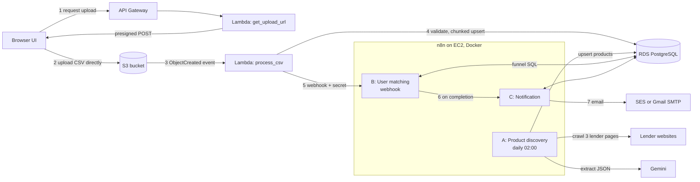

# Loan Eligibility Engine

Upload a CSV of users, discover personal loan products from lender websites, match every user to the products they qualify for, and email them. Ingestion runs on Lambda and S3, data lives in PostgreSQL, and **all business logic runs in self-hosted n8n workflows**.

Runs two ways from the same code: fully local with Docker Compose, or on AWS with one command.

## Architecture



Locally, MinIO replaces S3, a small Flask app replaces API Gateway and the S3 event, and Postgres runs in a container. The Lambda handlers, workflows and SQL are identical in both. Details: [planning/architecture.md](planning/architecture.md).

### The pipeline

| Step | What happens |
|---|---|
| Ingestion | The browser gets a presigned POST URL and uploads the CSV **straight to S3**, so API Gateway and Lambda payload and timeout limits never apply. The S3 event starts a Lambda that streams the file, validates each row, and upserts users in chunks of 2,000. Latest row wins; a user is flagged for re-matching only if income, score, employment or age actually changed. Bad rows are rejected and counted, not fatal. |
| **A** Product discovery | Daily (and on demand). For each source: fetch, strip markup (about 95% smaller), hash the cleaned text. Unchanged pages stop here. Changed pages go to Gemini with a strict JSON schema, the output is validated, and products are upserted together with the new hash in one statement. |
| **B** Matching | Called by webhook after a CSV is processed (secret header required). Replies 202 immediately, then runs the funnel as one SQL statement and stores matches. |
| **C** Notification | Called by B. Emails each selected user their best 5 products and marks them notified only after a successful send. |

## The Optimization Treasure Hunt

**Idea: the LLM reads each product page once, not each user-product pair.** An LLM turns messy page text into structured columns. After that, "who is eligible for what" is deterministic, which is faster, free, reproducible and explainable, and that matters in lending.

| Stage | Where | What it does |
|---|---|---|
| 0. Incremental scope | SQL | Only flagged users and flagged products are evaluated: (flagged users × all products) ∪ (all users × flagged products) |
| 1. Hard rules | One set-based SQL join | income, credit score, age range, employment type; a null criterion means no constraint |
| 2. Rank and cap | `fit_score` (lower rate is better); top 5 applied when emailing | Keeps emails useful |
| LLM | Only at crawl time | One call per *changed* page. A hash of the cleaned page skips unchanged pages, and a second model takes over when the first is overloaded |

Real numbers from this repository's database (`match_runs` table):

| Run | Naive pairs | Pairs evaluated | Eligible | Skipped |
|---|---|---|---|---|
| First upload: 10,000 users, 8 products | 80,000 | 80,000 | 25,682 | 0% (everything is new) |
| Workflow B run with nothing flagged | 80,000 | 0 | 0 | 100% |
| One product's criteria changed | 80,000 | 10,000 | 929 | 87.5% |
| Crawler added 4 real products | 120,000 | 40,000 | 8,179 | 66.7% |

Re-uploading an unchanged file produces the "nothing flagged" case above: re-ingesting the identical 10,000-row file flags 0 users, one changed income flags exactly 1, and a name-only change flags 0.

An LLM-per-pair design would need 120,000 calls for the same data. Here: **3 calls per changed crawl, 0 per user, 0 per pair**, and the funnel SQL runs in about a second (average workflow B execution: 1.1 s).

Honest limit: pages also carry criteria that are not numeric ("2 years of work experience"). These are stored as `residual_criteria`, but the CSV has no matching user fields, so nothing can be judged against them and they are not used for matching.

## Design decisions

| Decision | Why |
|---|---|
| Presigned POST + S3 event | Meets the "no API Gateway upload" requirement, with a server-enforced size limit and retries from the event |
| Business logic in n8n; heavy parsing in Lambda | n8n for orchestration and decisions; Lambda where volume and limits matter |
| Claim-and-match in one SQL statement | Flags are cleared and matches written in one transaction, so a crash cannot lose a flagged user; reruns are idempotent (`PRIMARY KEY (user_id, product_id)`) |
| `needs_match` / `needs_rematch` flags | Incremental work; changed products re-evaluate only themselves |
| Hash the **cleaned** text | Raw HTML changes daily from tracking tokens; cleaned text does not |
| Hash saved only after products are saved | A failed extraction retries on the next run instead of being skipped |
| Required-but-nullable schema fields | Without this the model silently dropped values it was unsure about |
| Validation after the LLM | Ranges and enums are enforced before anything reaches the database |
| Fallback model | Gemini returned 503 "high demand" during development; the same request now goes to a second model |
| One product per employment segment | ICICI's rules differ for salaried and self-employed applicants; blending them would be wrong |
| Matching starts only after a CSV is processed | As the brief specifies; products found later are matched on the next upload |
| Demo email guard | Recipients come only from `NOTIFY_RECIPIENTS`, never from the CSV, and each run is capped at `NOTIFY_LIMIT` (2) |
| No NAT gateway on AWS | Lambda, RDS and n8n share one VPC; S3 is reached through a free gateway endpoint (saves about $32/month) |

Not built on purpose: authentication, user accounts, OAuth, multi-region, queues for scale beyond a small user base.

## Run locally

Prerequisites: Docker, Python 3.12, and a Gemini API key.

```bash
cp .env.example .env            # fill in passwords, GEMINI_API_KEY, GMAIL_APP_PASSWORD, NOTIFY_RECIPIENTS
docker compose up -d --build    # Postgres, MinIO, API, n8n; migrations run automatically
```

1. Open http://localhost:5678 and create the n8n owner account.
2. `python scripts/n8n_setup.py` imports the credentials and the three workflows from this repo and publishes them (standard library only; it drives `docker compose exec`).
3. In n8n, open **A - Loan Product Discovery** and click **Execute workflow**.
4. Open http://localhost:8000 and upload `data/demo_users.csv` (or `data/users.csv`).
5. Watch the status steps. Workflow C emails up to 2 users, to your `NOTIFY_RECIPIENTS`.

`data/demo_users.csv` is 20 users plus three edge cases: a repeated user with a new income (latest wins), an invalid user ID, and an out-of-range score.

### Credentials in n8n

`scripts/n8n_setup.py` creates these from `.env`, encrypted with `N8N_ENCRYPTION_KEY`. To create them by hand instead, use **Credentials → Add credential**:

| Name (ID) | Type | Values |
|---|---|---|
| App Postgres (`app-postgres`) | Postgres | host `postgres`, port 5432, database and user from `.env` |
| Gmail SMTP (`gmail-smtp`) | SMTP | `smtp.gmail.com`, 465, SSL, your Gmail address and an app password |
| AWS SES (`aws-ses`) | AWS | region, access key, secret (AWS deployment only) |

The webhook secret, Gemini key and demo limits are environment variables of the n8n container and are read in nodes as `$env.*`; no secrets are stored in the workflow JSON files.

## Deploy to AWS

```bash
cp .env.aws.example .env.aws    # fill in
npm install
python scripts/aws_deploy.py
python scripts/aws_teardown.py  # delete everything when done
```

Full steps, costs and troubleshooting: [docs/aws-deployment.md](docs/aws-deployment.md).

Notes from a real deployment: SES starts in the sandbox, which only sends to verified addresses. Mail sent *from a Gmail address through SES* is accepted but filed under Spam by Gmail, so use your own domain for real use.

## Repository layout

```
serverless.yml          AWS stack (VPC, RDS, S3, Lambdas, API, n8n host)
docker-compose.yml      Local stack
n8n/workflows/          The three workflow exports (+ SES variant of C)
src/ingestion/          Upload, CSV parsing, validation, repository
src/common, admin, web  Shared config/db/storage, migrations Lambda, UI Lambda
db/migrations/          Plain SQL schema migrations
db/queries/             Reference copies of the SQL used inside n8n
scripts/                n8n setup, AWS deploy/teardown, migrations, seeds
tests/                  Unit tests for parsing and validation
planning/               Requirements, decisions, schema, architecture
```

## Tests

```bash
pip install -r requirements-dev.txt
ruff check . && pytest
```

16 unit tests cover row validation and CSV parsing (header handling, line numbers, in-chunk duplicates). Workflows were verified end to end against the real 10,000-row file and the three live lender pages.
