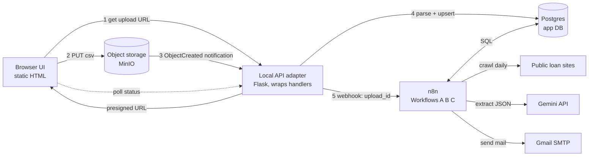
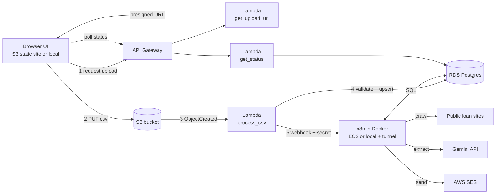
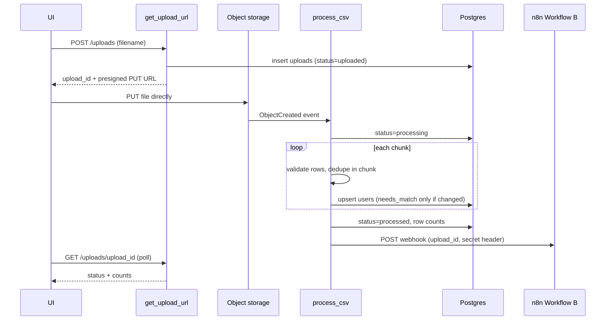
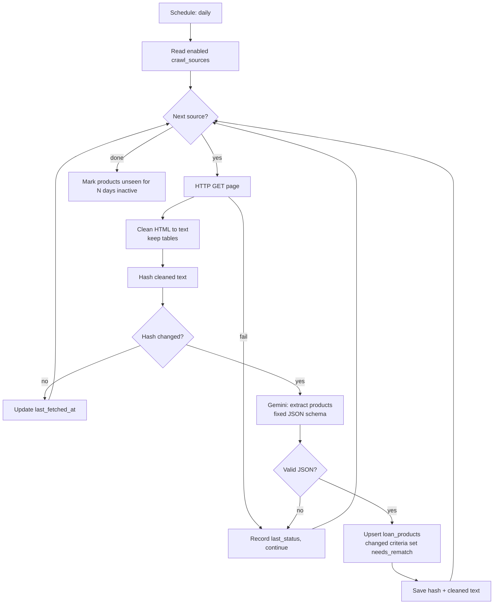
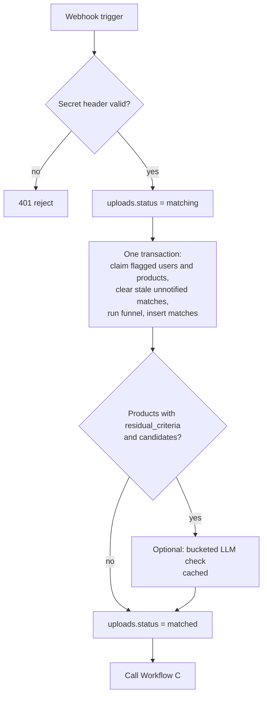
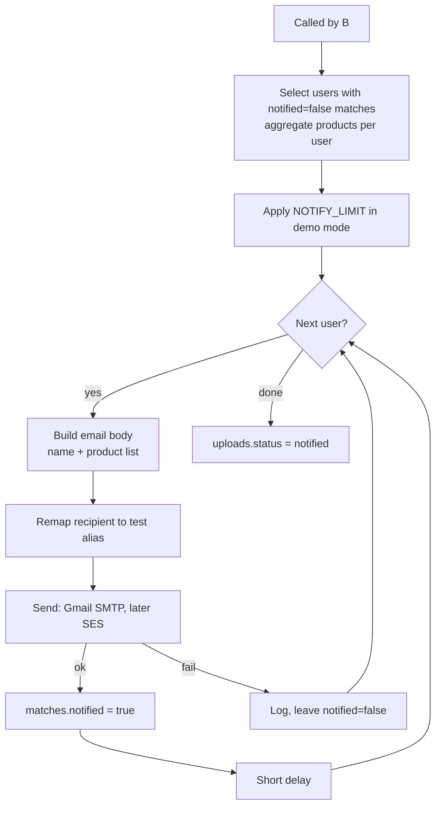
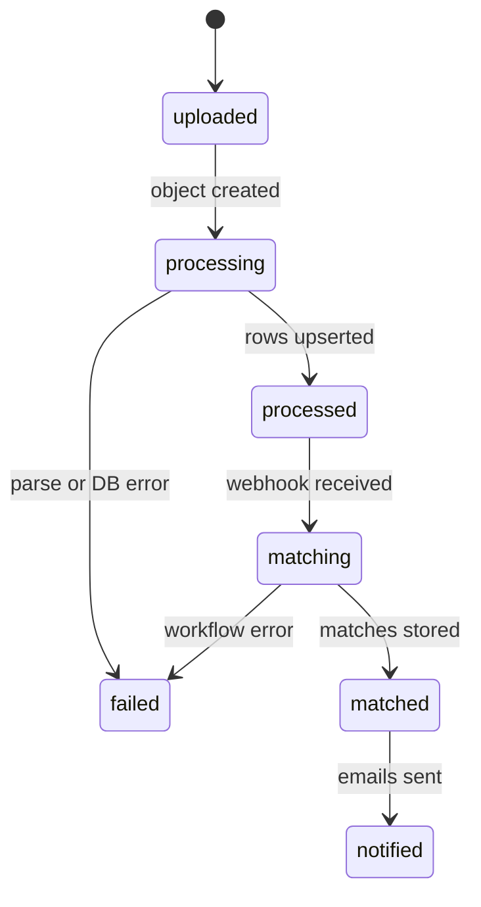

# Architecture

Diagrams are Mermaid (render on GitHub and in VS Code). Design rationale lives in [decisions.md](decisions.md); tables in [schema.md](schema.md).

## 1. V1 HLD: local (build target first)

Everything runs in Docker Compose on one machine.

| Component | Role |
|---|---|
| Local API adapter | Thin Flask app calling the same handler functions Lambda will run (presign, process CSV, status). Fallback if MinIO is unusable: it receives the file itself. |
| Postgres | One server, two databases: `app` (our tables) and `n8n` (n8n internals) |
| n8n | All business logic: A crawls, B matches, C notifies |

## 2. Final HLD: AWS

Same logic; adapters replaced by AWS services.

Open for this phase: where n8n runs (EC2 vs local + tunnel) and how Lambda/n8n reach RDS without a NAT gateway (public RDS restricted by security group, Lambda outside the VPC).

## 3. Flow: ingestion

## 4. Flow: Workflow A (product discovery)

## 5. Flow: Workflow B (matching)

Funnel stages (details in decisions.md): 0 scope (flagged only) → 1 SQL hard-rule join → 2 rank and cap top N per user → 3 optional bucketed LLM. The LLM never sees the DB; n8n passes only the needed fields.

## 6. Flow: Workflow C (notification)

## 7. Upload status lifecycle

## 8. Trust boundaries and secrets

| Boundary | Protection |
|---|---|
| Processor → n8n webhook | Shared-secret header |
| n8n → Postgres, SMTP/SES, Gemini | Credentials in n8n store only |
| Upload | Short-lived presigned URL; size and content-type limits |
| Prompts | No emails or names sent to the LLM |
| Email | Recipients always remapped to test aliases |
